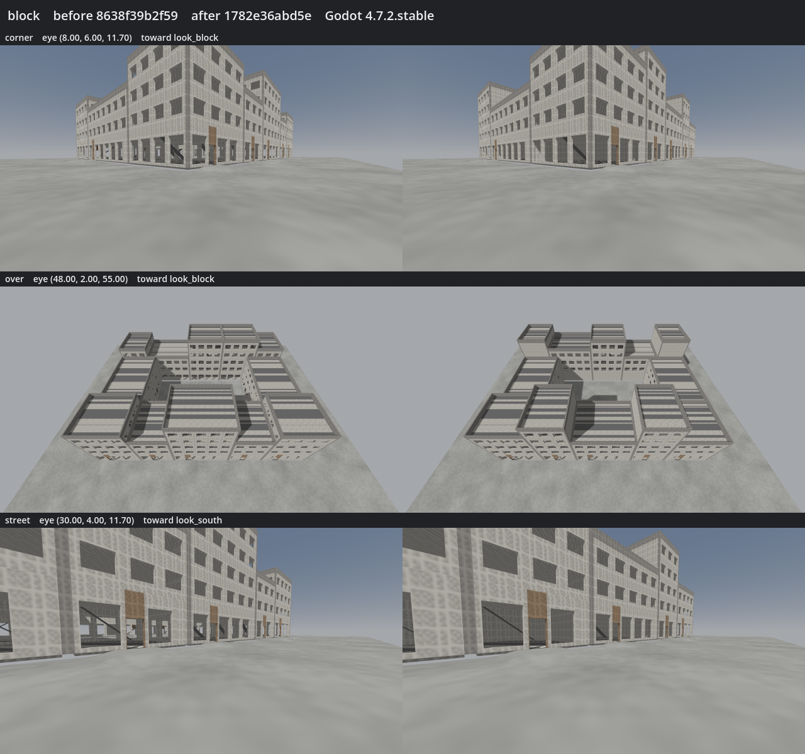

# block: a city block from one kit

One block of a modern city, twelve buildings round a yard, walled from a grey kit made by code.
It is K6 of `docs/plan-kits.md`: what a world's author has to write to place buildings side by
side, what the build says when they do not fit, and what it could not say before.

The pattern is the best evidenced of the six styles: a block is frontages cut into lots, a
facade is read by storey (a ground storey of shopfronts, repeating storeys, a roof), buildings
share party walls, and neighbours differ (`docs/research/Modular city asset contracts.md`,
sections 2 and 5; `docs/research/Modular kit failures in studios.md`, sections 7, 8 and 11).

## What is here

| File | What it is |
|---|---|
| `packs/make_kit.py`, `packs/city.toml` | The city kit: fifteen pieces of one 3 m module. A bay with a window, the same bay blank and with two narrow windows, a half bay, a post and a door frame, 3.3 m high; a shopfront, a blank bay, a half bay, a post and a door frame for the 4.5 m ground storey; a floor tile; a bay, a half bay and a post of parapet. The kit states what they share once (`defaults.shared`). |
| `world.toml`, `walls.toml` | The block as four rows (`lib/building/row.py`). `walls.toml` is the layer above, where `lay` walls what the rows returned. |
| `by_hand.toml` | The same block as twelve `building` tables written by hand: what an author wrote before rows. Kept so the two can be measured against each other. |
| `changes/` | Nine changes to the rows and three to the block by hand (`hand_*`), each recreating one difficulty. |
| `measure.py`, `expect.toml` | What each build is measured by, and the measured numbers with their protocol. |

```sh
python3 examples/block/packs/make_kit.py
via pack accept examples/block/packs/city.toml
export VIA_LIB=$PWD/lib
via trust examples/block/world.toml --yes
via build examples/block/world.toml --out build/block --store build/block.store
python3 examples/block/measure.py build/block --world examples/block/world.toml --check base
```

## By hand

`by_hand.toml` is the block written with what the building library had before K6. A building's
`region` is the outer face of its walls, and it closes on the kit only when every side is whole
bays and two corner posts: 3 m a bay and 0.6 m for the posts. So every coordinate is a sum the
author works out: 12 buildings, 192 numbers.

| What the author cannot see from a region | Measured | What the build said |
|---|---|---|
| A window or a shopfront against a neighbour's wall | 312 | Nothing |
| A shopfront on the yard | 36 | Nothing |
| Two neighbours of one size and height | 1 pair | Nothing |
| The stair of a building of four storeys or more: its third flight over its first | 10 pairs | 10 `geom.unowned_crossing`, each false: the two flights are two storeys apart |

And three changes made by hand:

| Change | What it recreates | What the build said | What it did |
|---|---|---|---|
| `hand_lots` | The south side cut into five lots of 12 m, as a lot-cutting rule would | `wall_open` for every stretch, each with the two nearest lengths that close; `gap_wide` at five doors | 38 stretches unbuilt, 380.7 m of wall over 19 storeys |
| `hand_widen` | One building made a bay wider | 107 `place.crowded`, one for each two pieces in one place | The wider building stands 3 m into the next. Nothing else moved: each neighbour is a table of its own |
| `hand_setback` | The top storey drawn back from the street, as an author guessed the key before it existed (`side`, where the key takes `sides`) | Before K7: `doc.unknown_key`. Now `params`: it is not `{ storey, sides, by }`, with what each is | Nothing built |

## As rows

A row is a frontage and its lots, in the kit's own unit:

```toml
[feature.south]
kind     = "row"
at       = [18, 16]
to       = [78, 16]
kit      = "structure/city"
depth    = 4
lots     = [{ bays = 4 }, { bays = 3 }, { bays = 5 }, { bays = 3 }, { bays = 4 }]
heights  = [3, 4, 5]
fill     = [{ faces = ["party"], pattern = ["blank"] }, { faces = ["back"], storeys = [0], pattern = ["blank"] }]
```

The step sizes each building from the kit's stated module and its corner's reach, stands them wall
to wall on the left of the way from `at` to `to`, gives each a door in a bay of its front and the
kit's stair along its back, and tells each which of its sides faces a neighbour. `lay` walls them.

| | By hand | As rows |
|---|---|---|
| Tables the author writes | 12 buildings | 4 rows |
| Numbers the author writes | 192 | 52 |
| Windows and shopfronts against a neighbour's wall | 312 | 4 |
| Shopfronts on the yard | 36 | 0 |
| Neighbours alike | 1 pair | 0 |
| Open wall | 0 | 0 |
| Warnings | 10 (0 since R71) | 0 |

The four that are left: one bay of the back of each of two north buildings, on the two storeys
below the eaves of the building round the corner, which stands against 3 m of a back of 12.6 or
15.6 m. A side has one word for what it faces, and less than half of these is a party wall.

## What each change shows now

Each row is one build against the base (`world.toml`).

| Change | The difficulty it recreates | What the build says | What the build does |
|---|---|---|---|
| `frontage` | The facade that does not divide: the south frontage 2 m longer than its lots | `row_open`: the lots take 60 m and stop 2 m short; the difference is no whole number of bays | Nothing moves: no lot is stretched to hide it |
| `widen` | The district border: the second building of the south row a bay wider | `row_open`: the row runs 3 m past its frontage, which is 1 bay, to take from a lot | The three buildings after it move 3 m along; none stands in another (by hand: 107 `place.crowded`) |
| `corner` | Two rows that both run to a corner: the west row written along the whole west side | 2 `row_meets`, each naming the lots it stands in and the `at` or `to` that clears them | The two end lots are not returned; the middle one stands as before under another name (it is now lot 1) |
| `alike` | Neighbours that repeat: the long rows with no `heights` | Nothing | 1 pair of neighbours alike. With `heights` there is none |
| `no_fill` | What fill by facing is for: the rows with no `fill` | Nothing | 312 openings against a neighbour and 36 shopfronts on the yard, as by hand |
| `narrow` | A lot two bays wide in the south row | Nothing | Its stair climbs its side, since its back is too short for the kit's stairwell. Every wall and floor closes |
| `shallow` | A lot no side of which holds the kit's stair: the west side as two lots two bays deep | `row_stair`: lot 0, 2 bays wide and 3 storeys high, is not returned | 12 buildings: the second lot stands, and the first is a gap |
| `tall` | A building of eight storeys | Nothing (before R71: a false `geom.unowned_crossing` for every flight over another) | Seven flights in two lanes; every floor whole tiles round the stairwells |
| `setback` | A set-back: the east building's top storey a bay back from the street | `slab_open`: 14 tiles of the terrace cannot be laid whole, it is 2.7 m deep inside its parapet; `wall_open`: 2.4 m of the terrace's parapet at each end | The storey's walls close on its own outline and the roof covers it. The terrace has one row of whole tiles, its front parapet and four posts; 1.2 m of its depth and its two side parapets are open (below) |

## Pattern against archetype

| Pattern of a city block | Archetype (`docs/ledger/archetypes.md`) | Where it lives now | Verdict |
|---|---|---|---|
| A frontage cut into lots of whole bays | Linear placement, law 5 (a length is whole pieces, or refused and said) | `row.py`, `row_open` | Holds. No archetype added |
| A facade by storey: ground, repeating, roof edge | Grammar; Asset law 5 (the kit states what its pieces share) | `storey:` tags, `shared`, the parapet as a storey kind of its own | Holds |
| Party walls: what a side faces | Not Asset, not Placement: a relation between two buildings | `faces`, worked out by `row.py`, read by `fill` | Holds for whole sides. A side partly against a neighbour is not said (4 windows) |
| Neighbours that may not repeat | Linear placement, law 6 (a choice by place, the same in every build) | `heights` | Holds for height. Not for the facade's variant or the lot's width |
| A corner building with two fronts | Linear placement ends | `end` in `faces` | Holds: an open end is a second front. Its door is on one street only |
| Two rows meeting at a corner | Area partition (a block is its frontages) | `row_meets` refuses the second | Said, not solved: the author still writes where each side's row starts. The block needs a table of its own |
| Stacked stairs | Meeting (two paths meet only on one level) | Core, R71 | Holds |
| A set-back | Grammar: a storey with another outline than its building's | `setback`, lay.py rule 14 (K7) | Holds for the storey. The terrace does not close on this kit: whole bays less one wall is no whole number of its tiles or parapet pieces |

## Still open

- **The block is four statements, not one.** Each row repeats the kit, the depth and the `fill`,
  and the east and west rows are written 12.6 m in from the corners by hand, the one sum left.
- **A side partly against a neighbour.** 4 windows.
- **A party wall is blank to its top.** 68 blank bays look out over a lower neighbour's roof
  (`blank_above`): `faces` says what stands beside a side, not how high it stands.
- **Off the axes.** A row may run at any angle and finds its party walls; `lay` then lays no
  floor tile on a turned building and its walls meet by rounding (`lib/building/README.md`).
- **A terrace that closes.** A set-back of whole bays leaves a terrace one wall's thickness
  short of whole tiles and two posts short of whole parapet pieces. It is said; the kit has no
  piece for the difference.
- **A corner building's second door, and a chamfered corner.** Not built.
- **A lot's name is its number.** A lot written before others renames them (`corner`: 538
  instances removed and added again for a building that did not move).
- **What a row passes on is eight attributes of a building, named one by one.**

## The record

Measured 2026-11-23 on macOS arm64, release `via` of the working tree after aa93d3a, one fresh
store for each world, one build each; the numbers and their protocol are in `expect.toml`.

Before any mend (the tree at aa93d3a, `by_hand.toml`): the four rows of "By hand" above, and
`hand_widen` at 103 `place.crowded`. The mends, in the order they were made: paths on two levels
do not meet (R71, in the core); a row of buildings in bays (`row.py`); `faces` and `fill` by it;
the parapet.

One independent review, eleven defects: nine mended, two mended in part with the rest filed in
`TODO.md` (where `lay`'s own records of a row's building are located; a flight that ends on a
wall, when written by hand). The crossing
rule as first written compared two heights at the one crossing point and hid real meetings (two
ramps on one line, a walk along part of a flight); it now compares the ranges of height over the
ground both paths cover. A row off the axes missed its party walls, since rings rounded to the
millimetre are no longer parallel; a `fill` naming a storey some lots lack stopped the build; a
kit that stated a wrong value raised in the step; and this page counted the views' numbers among
the author's (203 and 63, now 192 and 52) and said of `shallow` what its build did not do.



Left, by hand; right, as rows. From the corner, from above and from the south street. By hand the
shopfronts open onto the yard and onto the next building; as rows the party walls and the yard's
ground storey are blank and the heights differ along each street. Both have the kit's parapet
round every roof.

## Views

`corner` (the south-west corner from outside, at eye height), `over` (the block from the south,
45 m up), `street` (the south row from its street).
