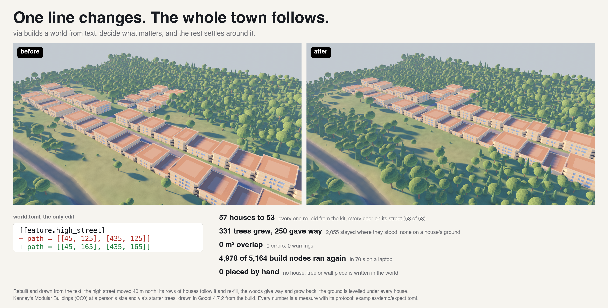

# examples/demo: one line changes, the whole town follows

The canonical demo (D of `docs/plan-fixes.md`; design note `docs/design/demo.md`): one world that
proves the tech and is a picture worth looking at, so that a person who sees it once knows why to
use via. A market town of Kenney's kit in a wooded valley. One line of its text, the high street's
path, is changed; rebuilt, its rows of houses re-plan along the moved street, the woods follow it
(their cover reads its distance) and keep off every house's plot, the ground is levelled under
every house, every door still opens on its street. Nobody touched a house or a tree.



The sweep, the same line moved in even steps, each step a real build drawn from one camera:
`docs/reports/demo-sweep.mp4` (and `demo-sweep.gif`).

```bash
python3 examples/borrowed/fetch.py                      # Kenney's models (CC0), never committed
via pack accept examples/demo/packs/demo.toml           # after a kit changes
via build examples/demo/world.toml --out build/demo --store build/demo.store
via build examples/demo/world.toml --change examples/demo/changes/north.toml --out build/demo+north --store build/demo.store
python3 examples/demo/sweep.py build/sweep              # every step built, drawn and measured
python3 examples/demo/compose.py build/sweep            # the hero and the video (needs PIL, ffmpeg)
```

| File | What it is |
|---|---|
| `world.toml` | The land, a stream, two streets, five frontage lines, where woods stand, the ground's paint, three views |
| `layers/town.toml` | Five rows of houses along the frontages (lib/building's `row`, rules 10 and 11) |
| `layers/walls.toml` | `lay` and `check` |
| `layers/growth.toml` | Woods, single trees and underbrush, scattered by cover, kept off the verges and every house's plot |
| `packs/demo.toml` | Two kits, each included whole (spec/assets.md 2.8): Kenney's at a person's size (`k_`), the starter pack's trees (`s_`) |
| `changes/north.toml` | The one line: the high street 40 m further north |
| `measure.py`, `expect.toml` | The measures, and the rows a build must hold |
| `sweep.py`, `compose.py` | The sweep (each step a build, drawn and measured) and the pictures from it |

## What it shows, and what holds it

What the hero and the sweep say is what `expect.toml` holds, by measures of `measure.py` with their
protocol: no number is typed into a picture. `compose.py` reads every figure from the measures the
sweep wrote, the "placed by hand" count too (`hand_placed`).

- **One line changed**: `changes/north.toml` is one table of one key; `written_features` and
  `written_numbers` count what the author wrote in the world.
- **Nothing placed by hand**: the world writes no house, no tree and no wall piece (`hand_placed`,
  0: no `[instance]`, no `[pin]`, no feature of kind `building`). Houses come from rows of
  `widths`, trees from scatters of cover. What the author does write by hand: the land, the
  stream, the streets, the frontage lines' offsets, where the woods stand, the views.
- **It settled**: houses re-laid, trees added and removed, by name against the base (a scatter's
  tree is named by its cell, so a tree that stays keeps its name). About half the trees that change
  do so because the woods' cover reads the street's distance, not because a house took their
  place.
- **It settled correctly**: 0 m² of overlap between houses, every door on its street, no tree on a
  house's plot, no warning.
- **What it cost**: the build nodes that ran again of the total, and the build's time on the
  machine that ran it (a time's band is wide: it is the machine's), the north change built straight
  after the base on one store, as the commands above do.
- **The same text gives the same world**: the base built on a fresh store gives the build digest
  the sweep's did (`820223d9…`, run records of 2026-11-25; spec/build.md 12).

## The look

The pictures are drawn by `engines/godot/showcase.gd`: Forward+, a low sun from the west, the sky's
light, a filmic tone map, ambient occlusion, a little haze. It is not the sheet tool's rig, which is
an instrument (a colour drawn is the colour declared); this one is made to be looked at. It loads
the build through the loader, as every engine view does, and adds nothing to it. No asset was made
for the demo: Kenney's kit and via's starter trees are what a person starting today has.

## What it does not show, said

- **A street off the axes.** lay tiles no flat roof on a building turned off them (TODO,
  lib/building), so both streets run along the axes, and the sweep moves the high street along one.
  Moving the lane's foot alone turned the lane, and with it its houses: no roofs, 42 crowded pieces.
- **The lane's rows start at a share of the lane** (TODO, lib/building): moved past 165, the high
  street's last house west of the lane and the lane's first meet, and one lot is refused
  (`row_meets`); the sweep stops at 165.
- **Speed.** Moving the high street moves almost everything, so almost every step re-runs: about a
  minute a build on a laptop. A build with `--against` the base writes the change report too, which
  for a world of this size takes longer than the build (TODO, the command).
- A river crossed by a bridge, people, traffic, interiors: not here.
