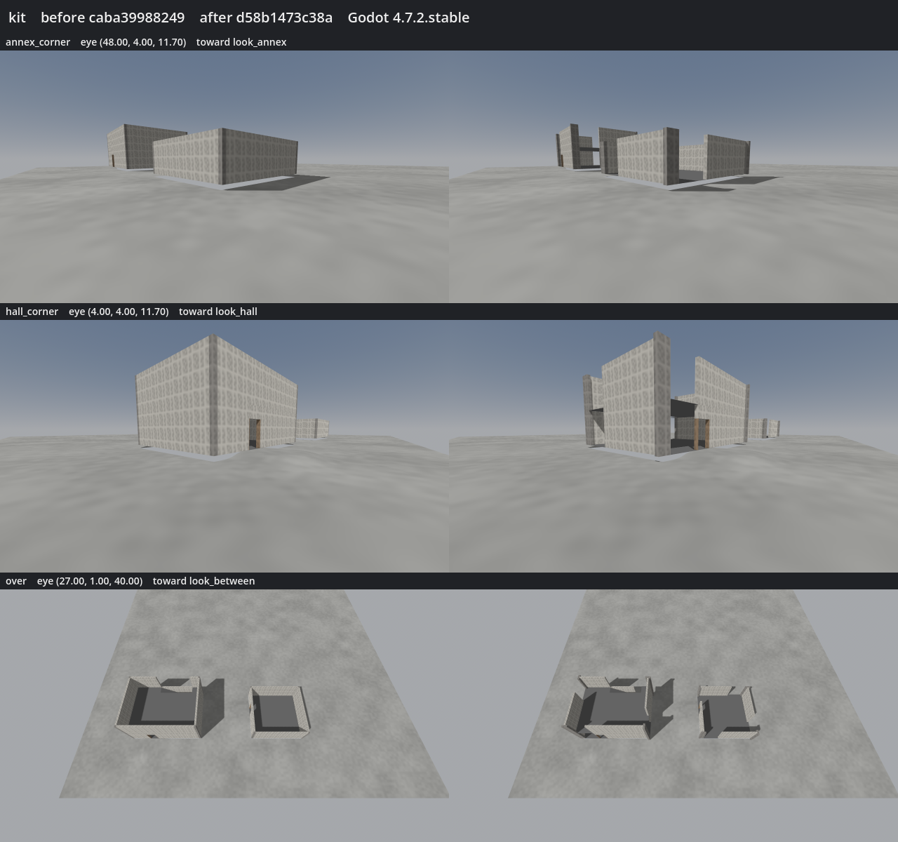

# kit

Two buildings from one plain kit, and eleven changes that each recreate a difficulty studios report
with modular kits (`docs/research/Modular kit failures in studios.md`, section 13). The example
asks one question of each: what does a build say, and what does it do?

It has been built three times, and each state is kept ("The record", below). First against the
tree as it stood, changing nothing, to record what the tool did. Then after the building library
was mended where the faults were its own. Then after two rulings on the engine's rules (R64, R65)
and the kit contract (`docs/design/kit-contract.md`). The table here is what the tool does now.

The kit is a studio's proof kit: untextured pieces at their exact sizes, the stage where a kit's
contract is settled before any art. It is grey on purpose.

| File | What |
|---|---|
| `world.toml` | Level ground, two `building` features (lib/building), the `lay` and `check` steps, three views. |
| `packs/plain.toml`, `packs/plain/` | The kit: `wall` (a 3 m bay), `wall_half` (1.5 m), `wall_window` (the bay with an opening), `corner` (a post for outside corners), `corner_in` (the piece for inside corners), `door` (a frame 1.5 m wide). Every piece 0.3 m thick and 3 m high. Made by `packs/make_kit.py`; facts in `plain.facts.toml`. |
| `packs/stub.toml`, `module.toml`, `pivot.toml`, `tall.toml` | The kit with one piece re-exported, written by `make_kit.py` from `plain.toml`; their facts files are the kit's, accepted before. |
| `changes/` | The eleven changes; `window` and `module` are also built together. |
| `expect.toml`, `measure.py` | What each build measured, with the protocol. |

## Build

```
export VIA_LIB=$PWD/lib
via config program python $PWD/sdk/python/.venv/bin/python
python3 examples/kit/packs/make_kit.py                           # only after editing it
via trust examples/kit/world.toml --yes                          # and once per --change
via build examples/kit/world.toml --out build/kit --store build/kit.store
via build examples/kit/world.toml --change examples/kit/changes/stub.toml \
    --against build/kit --out build/kit+stub --store build/kit.store
python3.11 examples/kit/measure.py build/kit+stub --base build/kit --check stub
engines/godot/sheet.sh --before build/kit --after build/kit+stub --out review/kit_stub
```

Trust each change on its own: four of them set `pack`, and two changes that write one key cannot
be trusted in one command.

## The base

The hall is 12.6 by 9.6 m and two storeys; the annex is 9.6 m square and one. `lay` takes a
building's region as the outer face of its walls and stands a corner post inside each corner, so a
side between two corners holds its length less 0.6 m: 12 m (four bays) and 9 m (three bays). 53
pieces: 35 bays, 4 half bays, 12 corners, 2 doors. 0 errors, 0 warnings.

`measure.py` does not read what `lay` says of itself. It takes each building's outline, each piece's
place and the plan of each piece's model, and measures how much of every side of every storey is
covered. The base has no overlap, nothing outside an outline, and one open stretch: 6 m of the
hall's upper north wall, over the stairwell, where `lay` builds no wall (lib/building/README.md,
"not built").

A door and a stair are written by a side of the outline and a distance along it (`side`, `at`), so
they keep their place when another side grows.

Three things were worked out by hand to make the base close, before the build could say them. It
says each now (`door_off`, `stair_off`, `off_module`, below):

- **The plan's sizes.** A side must be a whole number of half bays plus 0.6 m of posts.
- **The door's place.** The wall either side of the door is a whole number of half bays.
- **The stair's place and length.** The storey above leaves out its stairwell, from 1 m before
  the stair's foot to its head, and the wall either side of that must close too.

## What each change shows now

Each row is one build against the base. "Says" is the build's diagnostics; "does" is measured.

| Change | The difficulty it recreates | What the build says | What the build does |
|---|---|---|---|
| `pivot` | A piece's pivot moved late: the bay's model origin is at its end, not its middle | `asset.revised` names all 35 bays; `asset.pivot_moved` | 0 of 53 pieces move. The pivot is a rule of the pack, not the model's origin |
| `stub` | A corner piece re-exported with a 0.6 m stub along one wall | `asset.revised` names all 12 corners; `kit_corner`: 0.9 by 0.3 m where 0.3 m square is laid for; 12 `place.crowded`, each naming a corner and the wall piece it overlaps | Nothing gives way. The walls are whole; 12 overlaps of 0.3 m, and the corners reach 0.3 m outside the outlines |
| `module` | A piece's module changed late: the bay on a 3.2 m module | `fillers_only`, once per building; `kit_module`: 3.2 m is no whole number of 1.5 m | 74 half bays stand where 35 bays and 4 half bays stood; the walls close |
| `tall` | A piece that no longer stacks: the bay 3.3 m high on a 3 m storey | `asset.revised`; `kit_height`: 0.3 m into the storey above; `kit_uneven` | The hall's ground-storey bays stand 0.3 m into the storey above |
| `off_module` | The plan leaves the module: the hall a metre longer | 3 `wall_open`, each with the two nearest lengths that close; `gap_wide` beside the door | Three stretches unbuilt (13 m, 13 m, 5.5 m); 1 m open beside the door. The door and stair keep their places |
| `door_off` | A door half a metre off the module | `gap_wide`: the wall leaves 3 m; put its middle 4.05 or 5.55 m along side 0 | 1.5 m open beside the frame |
| `wide_door` | A door off the kit's door size: 1.6 m where the frame is made for 1.4 m | `gap_wide`: the wall leaves 4.5 m where 1.7 m is needed; no place on this side closes round it | 1.5 m open either side of the frame |
| `stair_off` | A stair that does not fit the module | 2 `wall_open`, each "it ends at the stairwell" with how far the wall is off | The storey above has 0.7 m and 5.8 m of wall unbuilt |
| `ell` | An inside corner: the annex as an L | Nothing | Every side closes with the kit's inside corner piece |
| `window` | One bay swapped by hand for a window bay | `identity.pin_removed` names 1 | The window takes its bay's place, on its floor. Its `at` carries the floor's height |
| `window_up` | The same swap on the storey above | `identity.pin_removed` names 1 | One bay swapped upstairs; the wall under it untouched |
| `window` and `module` | The swapped bay, then the module changed under it | `identity.pin_removed` names 2; `fillers_only`; `kit_module` | The pin keeps its place and takes the two half bays under it, on its own floor |

Every fault is now said, with its cause, and no build removes a piece on its own account. No
build stops: each is a warning. Whether some should be errors is open (`TODO.md`).


The base (left) and `ell` (right), from `engines/godot/sheet.sh`: the annex as an L, closed.

## The inside corner

Why no L closed before the mend, and what closes it.

`lay` shortens a side by what the corner at each end takes from it. With a post at every corner
that is the post's width (0.3 m) at an outside corner and nothing at an inside one, where the post
fills the notch the two walls leave. Take an L whose west side is `Y` long, and whose east side is
two sides of `c` and `e` with the inside corner between them, so `Y = c + e`. For all three to
close on a 1.5 m half bay:

- `Y - 0.6`, `c - 0.6` and `e - 0.3` must each be a multiple of 1.5.
- Then `c + e` is 0.9 more than a multiple of 1.5, and `Y` is 0.6 more. They cannot be equal.

Every L leaves a side 0.3 m off each way, whatever its size. It closes only if the kit has a piece
as long as the wall is thick. `examples/station` had one: a 0.1 m slip. Its loft, a plain
rectangle, took 46 of them, nine on each short wall, because its sides were not sized to the kit.
That is the patch piece studios name as the cause of kit bloat. The loft is now sized to its kit
and the slip is gone (K2).

Studios answer this in the corner piece: an inside corner and an outside corner are two pieces,
each taking a stated length from both walls it joins, chosen so what is left is whole modules.
`lay` now reads that length (`params.reach` on a corner piece) and takes `role:corner_in` at an
inside corner. This kit's inside corner reaches 1.2 m along each wall; with the post's 0.3 m at
the side's other end that is one half bay, and `e - 1.5` takes the place of `e - 0.3` above, so
the sums agree.

## Still open

- **The wall over a stairwell.** `lay` builds none (K4): 6 m open in the hall, in every measure
  here.
- **A pin with two numbers stands on the terrain,** and the terrain counts as one level with every
  floor whose kind cuts the ground away (R40), so such a pin under an upper floor still removes
  what stands on it. A height in `at` is what says the floor.
- **A side is named by its number.** A plan that gains a corner renumbers the sides after it, so
  the annex's door is on side 0, which `ell` does not move.
- **Variants.** `wall_window` is placed by a pin only: `lay` takes the first piece of a role (K3).
- **Warning or error.** A wall that does not close builds, with a hole and a warning.

## The record

The same builds at three states, same protocol as `expect.toml` (2026-11-20).

| Change | Before any mend (640a7df) | After lib/building's first mends | Now |
|---|---|---|---|
| `pivot` | Named; 0 moved | The same | The same |
| `stub` | Revision named; 12 pieces removed, 30.9 m of wall, said in infos | Fault named (`kit_corner`); 12 pieces still removed | Nothing removed; 12 overlaps named |
| `tall` | Revision named; the clash with the storey above not said | Said (`kit_height`) | Said |
| `off_module` | 3 of 4 open stretches said | All four said | All four said; the door and stair no longer restated |
| `ell` | 2 `wall_open`; two sides unbuilt, 8.4 m | Closes | Closes |
| `window` | Info names 3; 156 mm low; 6 m of wall removed upstairs | The same | 1 for 1, on its floor |
| `window` and `module` | Info names 4; 3 m of wall removed upstairs | The same | 2 half bays, on its own floor |
| `module` | Nothing said | Said (`fillers_only`) | Said, with its cause (`kit_module`) |
| `wide_door` | Nothing said | Said (`gap_wide`) | Said, with where it would close |

Before any mend: one right, six said in part, two silent. `window_up`, `door_off` and `stair_off`
were added with the mends they show.



The base (left) and `stub` (right) before the mends: twelve wall pieces give way to the corners.
Since R64 they stay.

## Not here

Roofs, slopes and styles. The research found no account by a developer of pitched roofs on plans
that are not rectangles, or of buildings that follow a slope, so an example of either would test
our own design with nothing to check it against. The buildings have no roof: the sheet shows the
walls' plan from above.

## Views

`hall_corner`, `annex_corner` (each building's corner from outside, at eye height), `over` (both
from the south, 30 m up).
