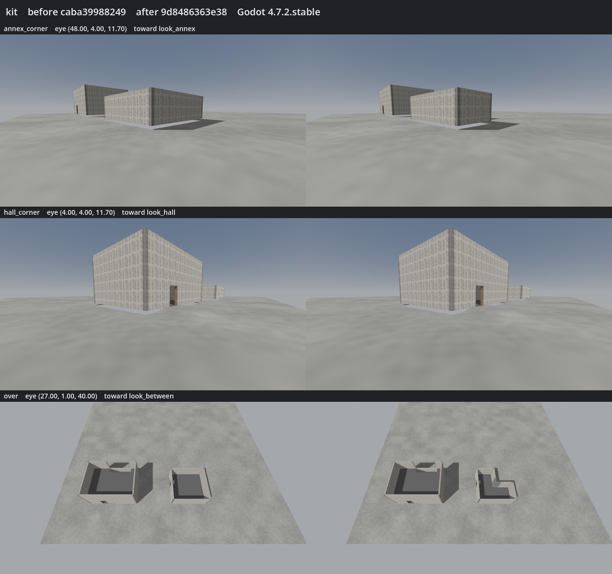
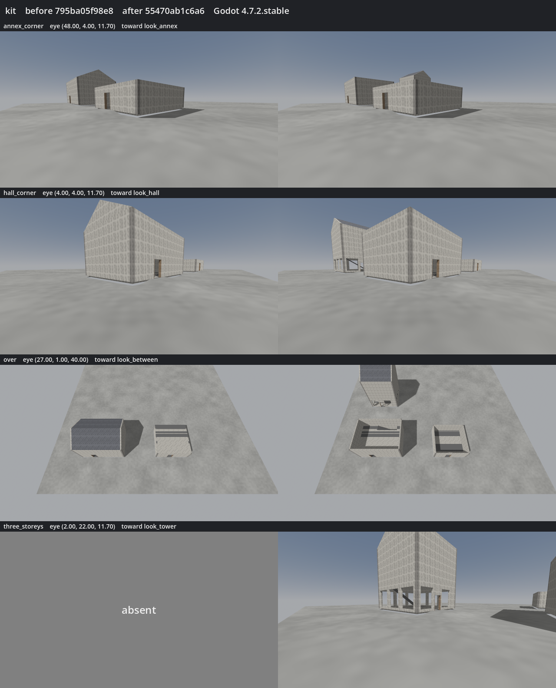
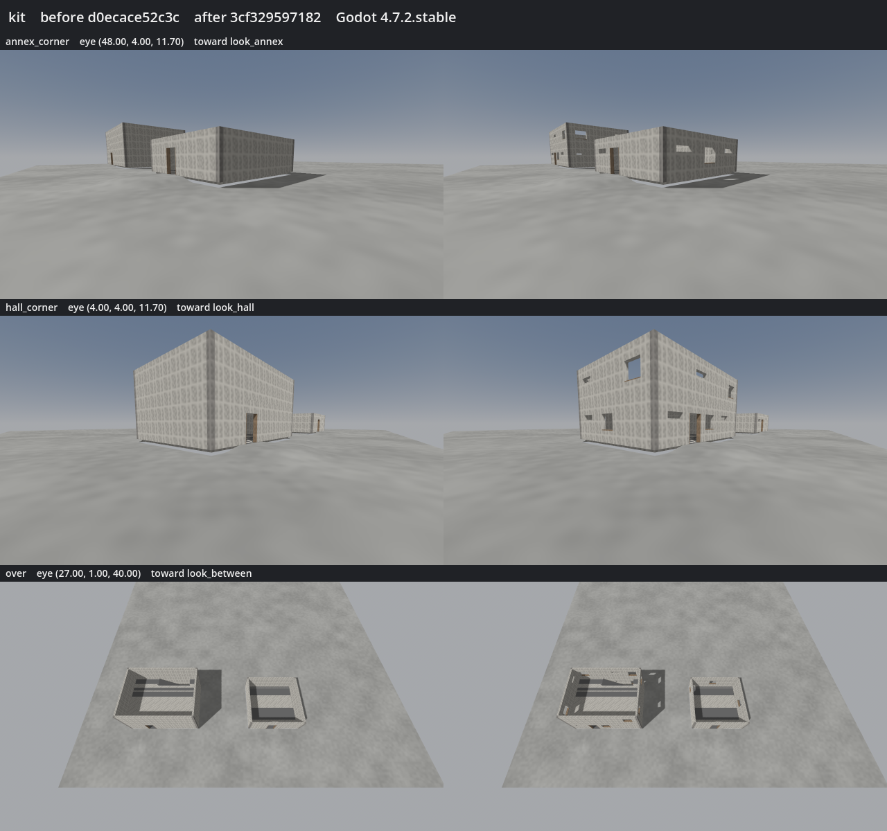

# kit

Two buildings from one plain kit, and twenty-one changes that each recreate a difficulty studios report
with modular kits (`docs/research/Modular kit failures in studios.md`, section 13). The example
asks one question of each: what does a build say, and what does it do?

It has been built three times, and each state is kept ("The record", below). First against the
tree as it stood, changing nothing, to record what the tool did. Then after the building library
was mended where the faults were its own. Then after two rulings on the engine's rules (R64, R65)
and the kit contract (`docs/design/kit-contract.md`). The table here is what the tool does now.
Four changes came later, with the variants of a piece (K3 of `docs/plan-kits.md`), and six with
building upward (K4): storeys of two heights, the wall over a stairwell, floors and roofs.

The kit is a studio's proof kit: untextured pieces at their exact sizes, the stage where a kit's
contract is settled before any art. It is grey on purpose.

| File | What |
|---|---|
| `world.toml` | Level ground, two `building` features (lib/building), the `lay` and `check` steps, three views. `changes/tower.toml` adds a third building and its view. |
| `packs/plain.toml`, `packs/plain/` | The kit, fourteen pieces. Walls: `wall` (a 3 m bay), `wall_half` (1.5 m), `wall_window` and `wall_vent` (the bay with an opening: its variants `window` and `vent`), `corner` (a post for outside corners), `corner_in` (the piece for inside corners), `door` (a frame 1.5 m wide), each 0.3 m thick and 3 m high. The same for a ground storey 4 m high: `ground_wall` (a shopfront bay), `ground_half`, `ground_corner`, `ground_door`. `floor` (a tile 1.5 m square, 0.2 m thick), `roof_slope` (1.5 m of roof from the eave to the ridge of a building 9.6 m deep) and `roof_gable` (half a gable). Made by `packs/make_kit.py`; facts in `plain.facts.toml`. |
| `packs/stub.toml`, `module.toml`, `pivot.toml`, `tall.toml`, `wide_window.toml` | The kit with one piece re-exported, written by `make_kit.py` from `plain.toml`; their facts files are the kit's, accepted before. |
| `changes/` | The twenty-one changes; `window` and `module` are also built together. |
| `expect.toml`, `measure.py` | What each build measured, with the protocol. |

## Build

```
export VIA_LIB=$PWD/lib
via config program python $PWD/sdk/python/.venv/bin/python
python3 examples/kit/packs/make_kit.py                           # only after editing it
via trust examples/kit/world.toml --yes                          # and once per --change
via build examples/kit/world.toml --out build/kit --store build/kit.store
via build examples/kit/world.toml --change examples/kit/changes/stub.toml \
    --against build/kit --out build/kit+stub --store build/kit.store
python3.11 examples/kit/measure.py build/kit+stub --base build/kit --check stub
engines/godot/sheet.sh --before build/kit --after build/kit+stub --out review/kit_stub
```

Trust each change on its own: five of them set `pack`, and two changes that write one key cannot
be trusted in one command.

## The base

The hall is 12.6 by 9.6 m and two storeys; the annex is 9.6 m square and one. `lay` takes a
building's region as the outer face of its walls and stands a corner post inside each corner, so a
side between two corners holds its length less 0.6 m: 12 m (four bays) and 9 m (three bays). 54
wall pieces: 38 bays, 2 half bays, 12 corners, 2 doors; and 128 floor tiles, on three floors. 0
errors, 0 warnings. Every wall is the one bay: 24 joints where a bay meets the same bay
(`alike`).

`measure.py` does not read what `lay` says of itself. It takes each building's outline, each piece's
place and the plan of each piece's model, and measures how much of every side of every storey is
covered. The base has no overlap, nothing outside an outline and no open stretch. Until K4 it had
one: 6 m of the hall's upper north wall, over the stairwell, where there was no floor for a wall
piece to stand on. That wall now stands on a footing, the top of the wall below, and is four bays
as on the ground (lib/building/README.md, "Building upward"). Floors are measured by sampling:
every square decimetre of each floor, inside the walls and off the stairwell, lies under exactly
one tile.

A door and a stair are written by a side of the outline and a distance along it (`side`, `at`), so
they keep their place when another side grows.

Three things were worked out by hand to make the base close, before the build could say them. It
says each now (`door_off`, `stair_off`, `off_module`, below):

- **The plan's sizes.** A side must be a whole number of half bays plus 0.6 m of posts.
- **The door's place.** The wall either side of the door is a whole number of half bays.
- **The stair's place and length.** Until K4 the wall either side of the stairwell had to close
  too. It no longer does; what the stair still owes the kit is a stairwell of whole floor tiles,
  which is why the hall's stair is 1.3 m wide.

## What each change shows now

Each row is one build against the base. "Says" is the build's diagnostics; "does" is measured.

| Change | The difficulty it recreates | What the build says | What the build does |
|---|---|---|---|
| `pivot` | A piece's pivot moved late: the bay's model origin is at its end, not its middle | `asset.revised` names all 38 bays; `asset.pivot_moved` | 0 of 54 pieces move. The pivot is a rule of the pack, not the model's origin |
| `stub` | A corner piece re-exported with a 0.6 m stub along one wall | `asset.revised` names all 12 corners; `kit_corner`: 0.9 by 0.3 m where 0.3 m square is laid for; 11 `place.crowded`, each naming a corner and the wall piece it overlaps | Nothing gives way. The walls are whole; 12 overlaps of 0.3 m measured, and the corners reach 0.3 m outside the outlines. The twelfth overlap is not named ("Still open") |
| `module` | A piece's module changed late: the bay on a 3.2 m module | `fillers_only`, once per building; `kit_module`: 3.2 m is no whole number of 1.5 m; 2 `kit_variant`: the window and vent bays are still 3 m | 78 half bays stand where 38 bays and 2 half bays stood; the walls close |
| `tall` | A piece that no longer stacks: the bay 3.3 m high on a 3 m storey | `asset.revised`; `kit_height`: 0.3 m into the storey above; `kit_uneven`; 2 `kit_variant`: the two variants are still 3 m high | The hall's ground-storey bays stand 0.3 m into the storey above |
| `off_module` | The plan leaves the module: the hall a metre longer | 3 `wall_open`, each with the two nearest lengths that close; `gap_wide` beside the door; 2 `slab_open` | Three sides unbuilt (13 m each: the north on both storeys, the south above); 1 m open beside the door; the floors a third of a tile short along one edge. The door and stair keep their places |
| `door_off` | A door half a metre off the module | `gap_wide`: the wall leaves 3 m; put its middle 4.05 or 5.55 m along side 0 | 1.5 m open beside the frame |
| `wide_door` | A door off the kit's door size: 1.6 m where the frame is made for 1.4 m | `gap_wide`: the wall leaves 4.5 m where 1.7 m is needed; no place on this side closes round it | 1.5 m open either side of the frame |
| `stair_off` | A stair that does not fit the module | `slab_open`: 5 tiles beside a stairwell 1.2 m deep, and the stair width that closes | Every wall closes (before K4: 0.7 m and 5.8 m of wall unbuilt either side of the stairwell, and 2 `wall_open`). 4.65 m2 of the floor above lies under no tile |
| `ell` | An inside corner: the annex as an L | Nothing | Every side closes with the kit's inside corner piece |
| `window` | One bay swapped by hand for a window bay | `identity.pin_removed` names 1 | The window takes its bay's place, on its floor. Its `at` carries the floor's height |
| `window_up` | The same swap on the storey above | `identity.pin_removed` names 1 | One bay swapped upstairs; the wall under it untouched |
| `window` and `module` | The swapped bay, then the module changed under it | `identity.pin_removed` names 2; `fillers_only`; `kit_module`; 2 `kit_variant` | The pin keeps its place and takes the two half bays under it, on its own floor |
| `windows` | A facade as a pattern of pieces: window and plain bays in turn on two walls of the hall, both storeys (`fill`) | Nothing | 8 bays are window bays; every wall closes as before |
| `mixed` | The same piece side by side: every bay chosen among window, vent and plain, never the piece before it (`fill` with a choice) | Nothing | 12 window, 15 vent, 11 plain; no two bays alike touch (24 pairs in the base) |
| `window_at` | An edit kept as an input: one bay named by a point along a side (`bays`), the swap `window_up` makes with a pin | Nothing | One window bay upstairs; no pin, nothing removed. Three names change for the one piece ("Still open") |
| `wide_window` | A variant that is not the bay's size: the window bay re-exported 3.2 m long, its pitch in the pack still 3 m, and asked for on two walls | `variant_none`, once: length 3.2 m for the bay's 3 m, the bay stands in its place; `kit_variant` and `kit_pitch` name the piece | No piece moves: 38 bays, no window, no overlap. The model's measured box is compared, not only the pitch the pack states |
| `tower` | Building upward: a third building, three storeys, its ground storey 4 m high, under a gable roof | `slab_open`: the second stairwell, two lanes and 2.9 m deep, is not whole tiles | The ground storey is the kit's 4 m pieces (11 shopfront bays, a half bay, 4 posts, a door), the two above its 3 m ones. Every side of every storey closes over both stairwells. The roof covers the outline once, on the eaves; its ridge and gables meet. 5.25 m2 of the top floor lies under no tile |
| `roofs` | Roofs from pieces: a gable over the hall, a flat roof of floor tiles over the annex | Nothing | 16 slope pieces and 4 gable halves on the hall, 36 tiles on the annex; each roof covers its outline once |
| `roof_ell` | A roof the kit cannot lay: a gable asked for over an L | `roof_none`: not a rectangle; the flat roof is laid in its place | The L is covered by tiles inside its walls; no slope piece is laid, cut or stretched |
| `roof_deep` | A roof piece is made for one depth: the hall 1.5 m deeper | `roof_none`: 11.1 m deep, the slope piece made for 9.6 m; the flat roof laid | The walls close on the deeper plan; the roof is flat |
| `slab_off` | A stairwell off the floor's module: the hall's stair 1 m wide | `slab_open`: 4 tiles beside a stairwell 1.2 m deep; a width of 1.3 m closes | The walls close; 1.8 m2 of floor, a strip 0.3 m wide along the stairwell, lies under no tile |
| `tall_ground` | A storey height the kit has no pieces for: the annex 5 m high | 3 `kit_height`: the 4 m bay, half bay and post each 1 m short | The nearest pieces are laid, the 4 m ones; the walls' tops stand 1 m under the roof |

Every fault is now said, with its cause, and no build removes a piece on its own account. No
build stops: each is a warning. Whether some should be errors is open (`TODO.md`).



The base (left) and `ell` (right), from `engines/godot/sheet.sh`: the annex as an L, closed.

## The inside corner

Why no L closed before the mend, and what closes it.

`lay` shortens a side by what the corner at each end takes from it. With a post at every corner
that is the post's width (0.3 m) at an outside corner and nothing at an inside one, where the post
fills the notch the two walls leave. Take an L whose west side is `Y` long, and whose east side is
two sides of `c` and `e` with the inside corner between them, so `Y = c + e`. For all three to
close on a 1.5 m half bay:

- `Y - 0.6`, `c - 0.6` and `e - 0.3` must each be a multiple of 1.5.
- Then `c + e` is 0.9 more than a multiple of 1.5, and `Y` is 0.6 more. They cannot be equal.

Every L leaves a side 0.3 m off each way, whatever its size. It closes only if the kit has a piece
as long as the wall is thick. `examples/station` had one: a 0.1 m slip. Its loft, a plain
rectangle, took 46 of them, nine on each short wall, because its sides were not sized to the kit.
That is the patch piece studios name as the cause of kit bloat. The loft is now sized to its kit
and the slip is gone (K2).

Studios answer this in the corner piece: an inside corner and an outside corner are two pieces,
each taking a stated length from both walls it joins, chosen so what is left is whole modules.
`lay` now reads that length (`params.reach` on a corner piece) and takes `role:corner_in` at an
inside corner. This kit's inside corner reaches 1.2 m along each wall; with the post's 0.3 m at
the side's other end that is one half bay, and `e - 1.5` takes the place of `e - 0.3` above, so
the sums agree.

## Still open

- **An overlap across a footing is not named.** The footing a wall stands on over a stairwell and
  the floor beside it are two surfaces at one height, and the core tests two things for overlap
  only when they stand on one (`spec/rules.md` 8.1). In `stub`, the corner on the footing
  overlaps a wall piece on the floor: measured, not said. `kit_corner` still names the piece.
- **The stair is not the kit's.** Its lanes and clearances are the library's numbers, so a
  stairwell is whole floor tiles only where the stair is sized by hand (1.3 m here), and the
  second stairwell of three storeys never is (`tower`).
- **No piece for a top storey.** A kit may tag a piece `storey:top` and a building may give its top
  storey a height (`top_h`); the library's tests hold both, and this kit shows neither.
- **A gable roof on rectangles only,** of the one depth its slope piece is made for. A gable over
  an L is K7's: on this kit the slopes beside a valley cannot be whole pieces where the walls are.
- **A pin with two numbers stands on the terrain,** and the terrain counts as one level with every
  floor whose kind cuts the ground away (R40), so such a pin under an upper floor still removes
  what stands on it. A height in `at` is what says the floor.
- **A side is named by its number.** A plan that gains a corner renumbers the sides after it, so
  the annex's door is on side 0, which `ell` does not move.
- **A variant renames the bays after it.** A run holds one asset, so a stretch with a variant is a
  run per spell of one piece, and the bays after the first spell take new names: `window_at`
  changes one piece and three names, `windows` seven of each. A pin on a renamed bay loses its
  target. The limit is the run's (`spec/rules.md` 5), ruled at K5.
- **Variants of the bay only,** and only of its size. A half-bay window, a double bay, a door or a
  corner with variants are not built; nor is a weight on a choice. Bays either side of a door, a
  corner or a half bay do not touch, so they are not kept unlike.
- **Warning or error.** A wall that does not close builds, with a hole and a warning.

## The record

The same builds at three states, same protocol as `expect.toml` (2026-11-20).

| Change | Before any mend (640a7df) | After lib/building's first mends | Now |
|---|---|---|---|
| `pivot` | Named; 0 moved | The same | The same |
| `stub` | Revision named; 12 pieces removed, 30.9 m of wall, said in infos | Fault named (`kit_corner`); 12 pieces still removed | Nothing removed; 12 overlaps named |
| `tall` | Revision named; the clash with the storey above not said | Said (`kit_height`) | Said |
| `off_module` | 3 of 4 open stretches said | All four said | All four said; the door and stair no longer restated |
| `ell` | 2 `wall_open`; two sides unbuilt, 8.4 m | Closes | Closes |
| `window` | Info names 3; 156 mm low; 6 m of wall removed upstairs | The same | 1 for 1, on its floor |
| `window` and `module` | Info names 4; 3 m of wall removed upstairs | The same | 2 half bays, on its own floor |
| `module` | Nothing said | Said (`fillers_only`) | Said, with its cause (`kit_module`) |
| `wide_door` | Nothing said | Said (`gap_wide`) | Said, with where it would close |

Before any mend: one right, six said in part, two silent. `window_up`, `door_off` and `stair_off`
were added with the mends they show. `windows`, `mixed`, `window_at` and `wide_window` came with
K3 (measured 2026-11-22), which also gave the kit its seventh piece; since then `module` and
`tall` name the bay's two variants as well, which a re-exported bay leaves at the old size.

K4 (measured 2026-11-23) changed every build by one thing: the wall over the hall's stairwell
stands, so `open` fell by one and 6 m everywhere and the hall has three more bays. `stair_off`
changed its meaning with it. On the tree before K4, a three-storey building on this kit left
15 m of wall open (12 m of it unsaid), `ground_h` was no key of a building, and a roof asked
for by a word the library did not know was passed over in silence.



`roofs` (left) and `tower` (right): a gable over the hall and a flat roof over the annex; a third
building of three storeys with its ground storey 4 m high.



The base (left) and `mixed` (right): each bay a window, a vent or a plain bay, chosen from where
it stands, no two that touch alike.


The base (left) and `stub` (right) before the mends: twelve wall pieces give way to the corners.
Since R64 they stay.

## Not here

Slopes and styles, and pitched roofs on plans that are not rectangles. The research found no
account by a developer of roofs from pieces, or of buildings that follow a slope, so the roofs
here test our own design with nothing but their own measures to check them against.

## Views

`hall_corner`, `annex_corner` (each building's corner from outside, at eye height), `over` (both
from the south, 30 m up). `tower` adds `three_storeys`.
