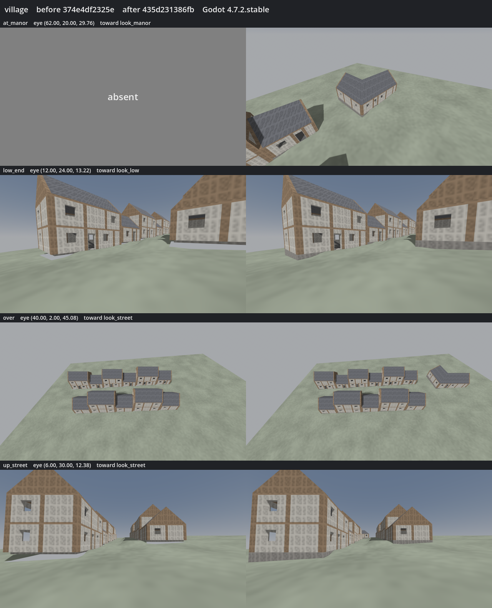

# village: a kit's houses on a slope

Two rows of timber-framed houses either side of a street that climbs a hill, walled from a grey
kit made by code. It is K7 of `docs/plan-kits.md`: how a kit's building meets ground that is not
level, what an overhanging storey asks of it, and a pitched roof on a plan that is not a
rectangle.

There is almost nothing to recreate from a studio here. The only shipped accounts are a stone
base under PUBG's modular buildings and a foundation layer under Fallout 4's facades, and the
tools that say anything state flat ground as a precondition (`docs/research/Modular kit failures
in studios.md`, section 4, "Meeting the ground"). The one failure a developer does describe is
about dependants: a studio enlarged its houses and broke a finished quest (section 12). So the
rule for the wall's foot is our own design, with its own measures to check it.

## What is here

| File | What it is |
|---|---|
| `packs/make_kit.py`, `packs/village.toml` | The village kit: a framed bay, the same with a window, a half bay, a post and a door frame, 2.7 m high; a floor tile; a roof slope and half a gable for a house two bays deep; a bay, a half bay and a post of base, 1.5 m deep; for a house on an L, the inside corner of the walls and of the base, a roof hip and a roof valley; a chest. `packs/bare.toml` is the kit with no base and `packs/shallow.toml` with a base 0.5 m deep. |
| `world.toml`, `walls.toml` | The street: two rows (`lib/building/row.py`), eleven houses, on ground that rises 8 m in 100 along the street and falls 6 in 100 to the north. `walls.toml` is the layer above, with `lay`, the check, and a chest written inside one house. |
| `changes/` | Nine changes. |
| `measure.py`, `expect.toml` | What each build is measured by, and the measured numbers with their protocol. |

```sh
python3 examples/village/packs/make_kit.py
for p in village bare shallow; do via pack accept examples/village/packs/$p.toml; done
export VIA_LIB=$PWD/lib
via trust examples/village/world.toml --yes
via build examples/village/world.toml --out build/village --store build/village.store
python3 examples/village/measure.py build/village --check base
```

## What a house does on a slope

`lay` puts each floor on the mean of the ground under its own outline, plus the plinth. So a
row steps by itself, house by house (0.66 m at most between neighbours here), and no floor is
level with the ground all round: it stands over the ground on the low side and in it on the high
side. A wall piece stands on its floor.

Before K7 (the tree at bc2ac73, the kit as first made, with no base):

| | Measured | What the build said |
|---|---|---|
| Houses whose walls stand over the ground somewhere | 11 of 11 | Nothing |
| Length of wall foot over the ground, party walls left out | 125.6 m of 125.6 m exposed | Nothing |
| The most a wall's foot stands over the ground | 0.87 m | Nothing |
| The most the ground stands over a floor at its wall | 0.27 m | Nothing |

On level ground it is the same in small: every building of every kit since M5 has stood its
plinth, 0.3 m, over the ground with nothing under its walls.

## The wall's foot

`lay` now reads the ground along the outline and holds the wall's foot against it
(`lib/building/lay.py`, rule 13). A kit's **base** is its wall pieces tagged `storey:base`, laid
round the outline as a storey's walls are, each sunk by its own height so that its top is the
floor. Where the base does not reach the ground, or the kit has none, the building says so.

| Change | What it recreates | What the build says | What the build does |
|---|---|---|---|
| (base) | The kit with its base, 1.5 m deep | Nothing | 142 base pieces; the base reaches the ground under all 125.6 m of exposed wall |
| `bare` | A kit with no base | `foot_open`, of each of the 11 houses: how far the ground falls below the floor, and along how much wall | 125.6 m of wall foot over the ground, 0.87 m at most |
| `shallow` | A base too shallow: 0.5 m | `base_short`, of each of the 11: how far the base stops short | 34.9 m of exposed base that does not reach the ground |
| `steep` | A street three times as steep | `base_short`, of 5 houses | Neighbours step 1.98 m at most; 4.0 m of exposed base stops short, by 0.13 m at most (the build, which reads party walls too, says 0.156 m). The chest is on a roof (below) |
| `flush` | No plinth | Nothing | The low side stands 0.57 m over the ground at most (0.87 m with the plinth); the high side is 0.57 m in it (0.27 m) |
| `wider` | The larger house: the first north house a bay wider | `surface.off_bound` on the chest; `place.gave_way`: 2 members | See below |

The build folds one step's records of one code into one, with a count and the first five names,
so `foot_open` of eleven houses is one warning whose numbers are the first house's.

## The larger house

The chest is written inside the second house of the north row, by its place and its floor's
height (`at = [26.9, 37.3, 12.225]`): the house is made by a step, so the world's text cannot
name its floor, and a height chooses among the floors at that point.

- **`wider`.** The first house grows a bay. The five after it move 3 m up the street, onto
  other ground, and their floors rise. The chest stays where it was written: now in the second
  house's west wall. The build says the chest lies partly off its floor (`surface.off_bound`),
  and two wall bays give way to it, since a hand's instance outranks a rule's: 6 m of that
  house's wall is open, said as an info (`place.gave_way`). The change report lists the chest
  among the 467 things that moved.
- **`steep`.** The ground changes under the chest's house, and 12.225 m is now the height of its
  eaves. The chest is on the roof, and four roof pieces give way to it.

Nothing ties the chest to its house: it is tied to a point and a height. That is the studio's
finding again, and the tool names the dependant only once the two disagree.

## A jetty

A timber house's upper storey stands out over the street. `overhang = [{ storey, sides, by }]`
gives a storey its own outline (`lib/building/lay.py`, rule 14), and every rule is then that
storey's on its own outline. Nothing is fitted to make it close.

| Change | What it recreates | What the build says | What the build does |
|---|---|---|---|
| `jetty` | A jetty of 0.45 m on the three two-storey houses of the north row | `wall_open` for each side wall of the upper storey: 6.45 m does not close; `roof_none`: the house is 7.05 m deep and the slope piece is made for 6.6 m; `slab_open` on the flat roof laid in its place | Six side walls unbuilt, 38.7 m; three flat roofs where gables were |
| `jetty_bay` | The jetty the kit can wall: half a bay, 1.5 m | `roof_none`: 8.1 m deep | Every wall closes, the storey's floor is its own underside over the street; three flat roofs |

So this kit cannot make a jetty a house would have. Its smallest wall piece is a half bay, and
its roof is one depth of house: a jettied storey needs a corner piece that takes the overhang,
and a slope piece of its own span. Both are the kit's to add; the library says which length
and which depth do not close.

## A roof over an L

No developer's account of pitched-roof pieces on an L was found; the nearest is a forum's rule of
thumb that a roof kit is built like a hallway kit, with a middle, an inner corner, an outer
corner and an end cap. So the decomposition is our own (`lib/building/README.md`, "A gable roof
over an L"): the square where the two wings cross is mitred along its diagonal, a hip from the
outer corner to the middle and a valley from the middle to the inside corner.

| Change | What it recreates | What the build says | What the build does |
|---|---|---|---|
| `ell` | A house on an L, both wings 6.6 m deep, under one gable roof | Nothing | The walls close with the kit's inside corner piece. The roof is 14 slopes on four eaves, two gable halves on each free end, a hip on the outer corner and a valley on the inside one: it covers the outline once (0 dm2 bare, 0 dm2 twice) |
| `ell_wide` | The same L with one wing 9.6 m deep | `roof_none`: a wing is 9.6 m deep and the slope piece is made for 6.6 m; both wings must be that deep | The flat roof in its place |

Before K7 a gable over an L was refused as "not a rectangle" (`examples/kit`, `roof_ell`). What
K4 found and filed is what the valley piece answers: the slopes beside a valley are whole pieces
only if the piece at the inside corner takes a stated length of each eave. Here that reach is
1.2 m, the reach the wall's own inside corner piece has on this kit, for the same reason.

## Pattern against archetype

| Pattern of a village on a slope | Archetype (`docs/ledger/archetypes.md`) | Where it lives now | Verdict |
|---|---|---|---|
| A stepped row: each house on its own ground | Linear placement over Grammar | `row.py` and `lay`'s levels, with no rule added | Holds |
| A base under the walls, down to the ground | Grammar: one more kind of storey, below the first | `storey:base`, the pack's `sink`, `base_short` | Holds. The base is one depth: a house on a steep slope needs a deeper base, not a taller one made from pieces |
| The wall's foot against the land | Meeting (a building and the ground) | `read_foot`, `foot_open` | Said. Nothing shapes the ground: no yard or pad of the building's own |
| A door's threshold | Meeting | The doorway holds the ground at its sill along its own path | Holds, by shaping the land: the ground climbs 1.04 m to the highest sill over the 8 m before it. Steps are not built |
| A thing inside a house | Placement by a height, not by the house | `at = [x, y, z]` | Does not hold: the thing follows the point (the larger house) |
| A pitched roof on an L | Grammar over Area: the roof is decided by the whole plan | `role:roof_hip`, `role:roof_valley` and its reach, lay.py rule 10 | Holds for an L of two wings of one depth. Any other plan is refused with its reason |
| An overhanging storey | Grammar: a storey with its own outline | `overhang`, lay.py rule 14 | Holds as a mechanism. This kit has no piece that closes a jetty smaller than a half bay, and no roof for the deeper storey |

## Still open

- **Steps to a door.** The doorway raises or cuts the ground to its sill over 1.5 m; a kit has no
  step piece, and a door over a metre of drop gets a mound.
- **A base made of courses.** The base is one piece of one depth. `base_short` says where it is
  too shallow; nothing stacks a second course under it.
- **A thing inside a house is not the house's.** It is written by a point and a height.
- **The ground is not shaped under a building.** Uphill the ground stands against the wall
  (0.27 m here, 1.02 m on the steep street), and nothing says so.
- **A jetty this kit can close:** a corner piece that takes the overhang, a roof slope of the
  deeper span.
- **A roof on a T, a U or a plan with an oblique wall;** wings of two depths; a pitched roof
  beside a flat one.

## The record

Measured 2026-11-23 on macOS arm64, release `via` of the tree at 26cb33f, lib/building of the
working tree, one fresh store, one build each: 158 of 158 rows over 10 builds (`expect.toml`).

One independent review of K7's three slices. Its probes of the roof over an L found it sound:
eight Ls, both hands and every turn, covered once and within 2 cm of the roof's own planes at
every point. It found six defects elsewhere, all mended. Two were in this page's measure: the
ground was read 0.6 m outside each wall, so at a party wall it was read inside the neighbour
(69 of the 190.1 m first written here), and the door's step was read where the doorway itself
sets the ground, so it could only be 0. The ground is now read on the outline, party walls are
left out, and the door's measure is the climb to it. A terrace's parapet was dropped on a
building whose name held `_w2_`; and 12 of 29 mutations stood, for which tests were added.



Left, the kit with no base (`bare`); right, the base, and the house on an L (`ell`) at the top of
the street. The L from above, the low end of the street, both rows from above, and up the street.

## Views

`up_street` (up the street from its low end, at eye height), `low_end` (the north row's lowest
house from the street), `over` (both rows from the south, 30 m up).
